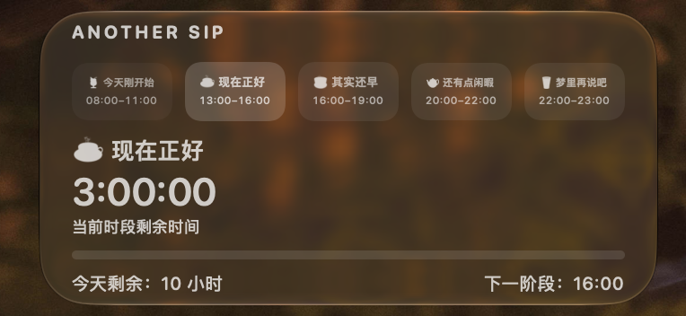

# Another Sip ☕️

> A customizable macOS desktop widget to organize your day into time blocks and track the time remaining in each. ☕️

Another Sip 是一款可以自由划分一天的 macOS 桌面时间小组件。你可以为不同时间段设置阶段名称和起止时间；需要 Emoji 时直接写在名称里。你也可以直接使用内置的五阶段预设。

它不会催你完成任务，也不要求一直打开主 App。保存设置后，桌面小组件会按照系统时间显示当前阶段、剩余时间、进度和阶段之间的空档。

## 默认五阶段预设

首次安装会载入下面这组示例。它们只是起点，不是固定规则：

| 时间 | 名称 |
| --- | --- |
| 08:00–11:00 | 🍹 今天刚开始 |
| 13:00–16:00 | ☕️ 现在正好 |
| 16:00–19:00 | 🍵 其实还早 |
| 20:00–22:00 | 🫖 还有点闲暇 |
| 22:00–23:00 | 🥛 梦里再说吧 |

你可以添加或删除阶段，修改每段的名称和起止时间，也可以在阶段之间保留休息空档。阶段名称可以直接包含 Emoji；阶段不必等长，也不必连续。

## 系统要求

- macOS 14 或更高版本
- Apple Silicon 与 Intel Mac（Universal Binary）
- 完全离线，不需要账号、服务器、Xcode或开发者账号
- 免费使用

## 下载与安装

1. 在 [Releases](https://github.com/tinaischristine/AnotherSip-Downloads/releases/latest) 下载 `AnotherSip.zip`。
2. 双击解压，把 `Another Sip.app` 拖入“应用程序”文件夹。
3. 双击打开一次 Another Sip。
4. 如果 macOS 阻止打开，关闭提示，前往“系统设置 → 隐私与安全性”，找到 Another Sip 并点击“仍要打开”。
5. 使用 Touch ID 或 Mac 登录密码确认，再点击“打开”。
6. 在 App 中修改阶段后，点击“保存并更新小组件”。
7. 在桌面空白处按住 Control 点击，选择“编辑小组件”，搜索 `Another Sip`，把小号或中号小组件拖到桌面。

这是 Apple 提供的单个 App 授权方式，不需要也不建议全局关闭 Gatekeeper。更详细的步骤请看 [中文安装指南](INSTALL_CN.md)。

## 为什么第一次打开需要确认

Another Sip 目前使用免费的 ad-hoc 签名，没有 Developer ID 签名，也没有经过 Apple 公证。这样可以在不加入每年 99 美元 Apple Developer Program 的情况下免费分享，但 macOS 无法自动验证开发者身份，因此首次运行需要由用户手动批准一次。

安装包不依赖个人开发证书或 Provisioning Profile，不存在 Personal Team 的 7 天到期问题。应用没有自动更新功能；新版本需要重新下载并替换旧 App。

## 当前版本

### 1.0.1

- Small 与 Medium 两种桌面小组件
- 1–12 个可自定义阶段
- 使用一个“阶段名称（可包含 Emoji）”输入框，不再单独设置 Emoji
- 支持名称、起止时间、添加、删除、顺序调整和恢复默认预设
- 阶段不能重叠，但可以保留空档
- 分钟级倒计时、进度、主题与 12/24 小时制
- 本地保存、完全离线

完整更新记录见 [Release Notes](RELEASE_NOTES.md)。

## 说明

这个仓库只用于公开下载，不包含 Another Sip 的 Swift 源代码或 Xcode 项目，也暂未采用 MIT、GPL 等开源许可证。
